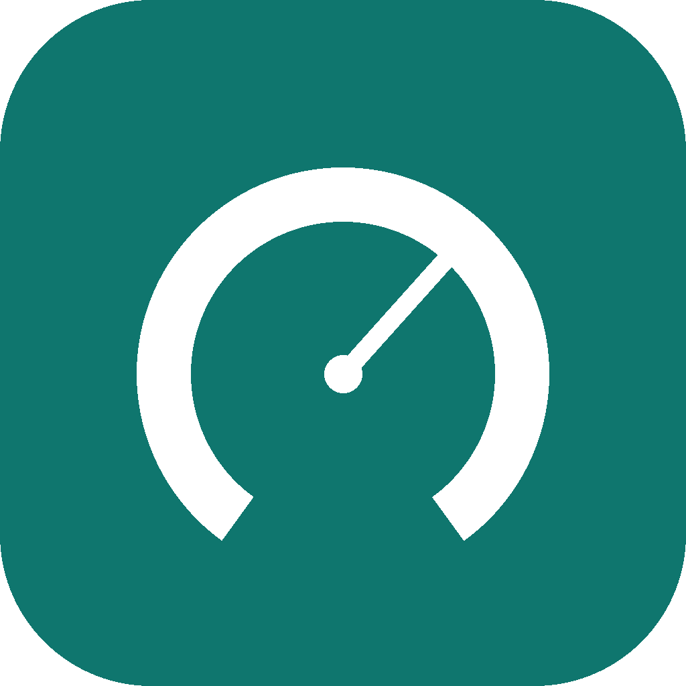

<div align="center">
  

# Free Space

On-device disk optimizer for Android. Scan large photos and videos, estimate savings, batch-compress what you select, then review before keeping both or replacing the original.


</div>

## Features

- Opt-in media library scan (photos + videos) after you grant access
- Multi-select with High / Medium / Low quality modes and estimated reclaim
- Sequential queue using Media3 for video and on-device image compression
- Side-by-side review: keep both or replace original (with confirmation)
- Hide file / folder filters and compression history that survive restarts
- No ads, no tracking, no internet permission

## Privacy

All processing stays on your device. See [PRIVACY.md](PRIVACY.md).

## Build

```bash
./gradlew :app:assembleDebug
```

Requires Android SDK / JDK 17+.

## License

MIT. Derived from [JoshAtticus/Compressor](https://github.com/JoshAtticus/Compressor); this project is a dedicated Free Space app, not a continuation of that product.
